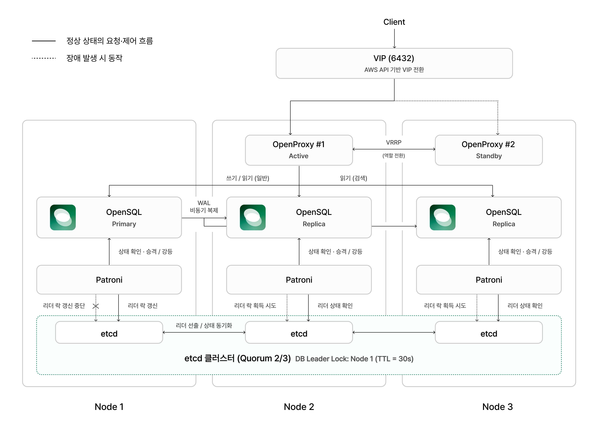

**한국어** | [English](OPENSQL_HA_CLUSTER.en.md)

# OpenSQL HA 클러스터 설계와 테스트

Tmax OpenSQL로 구성한 DB HA 클러스터의 설계, 구축하며 발견한 문제와 개선, 기능 시험 방법을 정리한다. OpenSQL은 상용 제품이라 라이선스가 있어야 이 구성을 띄울 수 있다. 이 문서의 결과는 티맥스티베로에서 제공받은 라이선스로, 팀이 별도로 운영한 DB 클러스터에서 측정했다. 실제 클라우드 인프라 구성은 [`terraform/`](../terraform/README.md)에 있다.

## 1. 클러스터 구성

OpenSQL 하나로 문서·권한 저장, 벡터 검색, 인덱싱 작업 큐를 모두 처리한다. DB 3대를 Patroni와 etcd로 묶고, 앞단의 OpenProxy 2대를 VIP 하나로 묶었다.

- **자동 장애 복구(Failover)**: Patroni는 etcd가 관리하는 리더 락으로 Primary 자격을 확인한다. Primary 장애로 락이 만료되면 승격 조건을 만족한 다른 노드가 락을 얻어 새 Primary로 승격한다. etcd는 과반수 합의로 리더 락의 일관성을 유지한다.
- **장애 노드 복구와 재합류**: 장애가 났던 기존 Primary는 복구 후 `pg_rewind`로 새 Primary와 데이터 이력을 맞추고, Replica로 재합류해 WAL 복제를 재개한다.
- **접속 경로 전환과 읽기 부하 분산**: OpenProxy는 Patroni의 상태 정보를 조회해 현재 Primary와 Replica를 구분하고 연결을 라우팅한다. 쓰기는 Primary로, 검색은 Replica로 보내며, Replica 사이에서는 연결 부하를 분산한다.

## 2. Watchdog 기반 Fencing

리더 락만으로는 막기 어려운 Split Brain을 어떻게 발견했고, Patroni의 Watchdog과 시스템 설정으로 어떻게 대응했는지 설명한다.

### 도입 배경과 설계

Patroni가 프로세스 중단이나 응답 지연으로 리더 락을 갱신하지 못해도, 기존 Primary는 즉시 쓰기를 멈추지 못할 수 있다. 이 상태에서 리더 락이 만료되어 다른 Replica가 승격하면 **Split Brain이 발생해 두 Primary가 동시에 쓰기를 처리하고, 데이터 정합성이 깨질 수 있다.**

이를 막기 위해 Patroni의 Watchdog을 켰다. Patroni가 정상으로 동작하는 동안에는 Watchdog 타이머를 주기적으로 갱신하고, Patroni가 멈춰 갱신이 끊기면 커널이 그 서버를 강제로 재부팅한다. Watchdog 타이머가 리더 락 만료보다 먼저 동작하게 설정해, **기존 Primary가 새 Primary의 승격 전에 쓰기를 멈추도록** 했다.

### 문제 발견과 개선

- **발견**: Patroni만 강제 종료했을 때 Watchdog에 의한 재부팅이 새 Primary 승격보다 약 2초 늦었다. 그 사이 Primary가 둘이었고, 성공 응답한 쓰기 4건이 유실됐다.
- **원인**: Watchdog을 켜는 것만으로는 충분하지 않았다. 타이머 설정상 기존 Primary의 재부팅이 리더 락 만료보다 늦어질 수 있었다.
- **개선**: Patroni의 상태 확인 주기(`loop_wait`)를 10초에서 5초로 줄이고, Watchdog의 안전 여유 시간(`safety_margin`)을 5초에서 10초로 늘렸다. 리더 락 유효 기간(`ttl`)은 30초로 유지했다.
- **재검증**: 같은 장애를 재현하자 기존 Primary가 새 Primary 승격보다 약 7.8초 먼저 재부팅됐다. Primary 중복 0초, 관측된 데이터 유실 0건이었다.

### 시스템 리소스 안정화

Watchdog은 Patroni가 멈췄을 때의 마지막 안전장치다. 이와 별도로 메모리 부족이나 스왑으로 Patroni가 지연·종료되는 상황 자체를 줄이도록 시스템 설정을 정비했다.

- **스왑 사용 억제**: `vm.swappiness`를 60에서 10으로 낮춰 메모리 압박 시 불필요한 스왑을 줄였다.
- **핵심 프로세스 보호**: OOM 점수를 조정해 Patroni와 PostgreSQL 본체가 메모리 부족으로 먼저 종료되지 않게 하고, 쿼리 프로세스는 따로 관리했다.
- **메모리 예산 조정**: 제한된 인스턴스 메모리에 맞게 PostgreSQL 설정을 조정해 과도한 메모리 사용 가능성을 낮췄다.

## 3. 복제 전략: 비동기 복제

데이터 정합성을 우선해 동기 복제를 검토했지만, 구성 요소 간 호환성 문제로 비동기 복제를 택한 이유를 설명한다.

### 도입 배경과 설계

성능과 데이터 정합성 중 하나를 골라야 한다면 정합성을 우선하기로 했다. 문서 관리 서비스는 쓰기 응답이 조금 늦어지더라도 데이터 유실 가능성을 줄이는 쪽이 중요하다고 보고, 처음에는 Patroni의 동기 복제 모드를 적용하려 했다.

### 문제 발견과 결정

- **발견**: 동기 복제 모드를 켜고 장애 복구를 검증하자 DB 연결이 끊겼다. OpenProxy가 쓰기 요청을 보낼 Primary를 찾지 못했다.
- **원인**: 동기 복제 모드에서는 복제 서버의 역할이 `sync_standby`로 표시되는데, 사용 중인 OpenProxy 1.1.3은 이 역할 정보를 처리하지 못했다.
- **결정**: OpenProxy를 직접 고치기 어려웠으므로, 자동 장애 복구와 DB 연결 경로를 안정적으로 유지하기 위해 **비동기 복제**를 채택했다. 그에 따라 생기는 장애 시 데이터 유실과 Replica 읽기 지연은 [7. 한계와 개선 방향](#7-한계와-개선-방향)에서 다룬다.

## 4. VIP 기반 OpenProxy 이중화

DB 3대가 정상이어도 앞단 OpenProxy가 멈추면 앱은 DB에 접속할 수 없다. OpenProxy 2대를 하나의 주소(VIP)로 묶은 방법과, AWS 환경에서 구현하며 부딪힌 한계와 해결 과정을 설명한다.

### 도입 배경과 설계

앱은 DB 주소로 VIP 하나만 쓴다. OpenProxy는 db-02(Active)와 db-03(Standby)에서 실행되며, OpenProxy에 내장된 VRRP로 둘 중 VIP를 가질 노드를 정한다. Active가 멈추면 Standby가 VIP를 넘겨받아 같은 주소로 접속을 이어 간다.

### AWS 환경의 한계와 해결

- **한계**: AWS는 사설 IP를 어느 서버로 보낼지 IP가 어느 네트워크 인터페이스(ENI)에 등록돼 있는지만 보고 정한다. 일반 네트워크처럼 새 주인이 "이 IP는 이제 내 것"이라고 알려도 AWS는 무시하므로, OpenProxy의 VRRP만으로는 VIP가 옮겨 가지 않는다. 두 OpenProxy가 주고받는 VRRP 신호(IP 프로토콜 112)도 보안 그룹에서 막혀 있었다.
- **해결**: OpenProxy가 VIP의 주인이 될 때 실행하는 훅(`pre_promote_script`)에서 AWS API를 호출해 VIP를 자기 ENI로 옮기게 했다. 이 요청에 필요한 권한은 두 ENI 사이에서 IP를 옮기는 것만 허용한 IAM 역할로 주고, 보안 그룹에는 VRRP 신호가 다닐 길을 열었다. 둘 다 Terraform 코드에 반영했다.

### 문제 발견과 개선

- **발견**: Active OpenProxy 프로세스가 3.4초 이상 멈췄다가 다시 동작하는 상황을 재현하자 VIP 접속이 완전히 끊겼다. 멈춘 사이 db-03이 VIP를 가져가면서 AWS의 VIP 할당도 db-03으로 옮겨졌다. 다시 동작한 db-02는 자신이 여전히 VIP 주인이라고 판단했고, db-03은 물러나며 VIP를 내려놓았다. AWS는 계속 db-03으로 트래픽을 보내고 있어 어느 노드도 VIP 트래픽을 받지 못했고, 수동으로 복구해야 했다.
- **원인**: AWS의 VIP 할당을 바꾸는 시점이 "VIP를 가져올 때" 하나뿐이었다. db-02는 멈췄다 다시 동작했을 뿐 상태가 바뀐 적이 없어 훅이 다시 실행되지 않았다.
- **개선**: VIP를 내려놓을 때 실행하는 훅(`pre_demote_script`)을 추가해, 물러나는 노드가 VIP를 상대 노드의 ENI로 넘기게 했다.
- **재검증**: 일시 정지 후 재개, 정지, 다시 시작, 강제 종료 네 경우 모두 VIP 접속이 1.5초 안에 회복됐다. 기능 시험 H-5(Active OpenProxy 정지)에서는 쓰기 중단 1.5초(기준 5초), AWS의 VIP 이동 2.6초였고, 원래 노드로의 복귀도 자동으로 이뤄졌다.

## 5. 쓰기 연결을 Primary로 고정

OpenProxy가 쓰기 연결을 Replica로도 보내던 문제를 어떻게 발견했고, 앱의 DB 접속 설정으로 어떻게 해결했는지 설명한다.

### 문제 발견과 개선

- **발견**: 기본 역할을 Primary로 지정한 풀인데도 OpenProxy 1.1.3이 이 설정을 적용하지 않았다(`SHOW SERVER ROLE` 결과 `any`). 이 풀로 30번 접속하자 Primary로 간 것은 8번뿐이었고, 나머지 22번은 Replica 2대로 흩어졌다. Replica로 간 쓰기는 실패한다.
- **개선**: 앱이 연결을 열 때 `SET SERVER ROLE TO 'default'`를 먼저 보내 풀에 지정한 역할이 적용되게 했다. transaction 풀에서는 이 지정이 한 트랜잭션 동안만 유지돼 풀을 session 모드로 바꿨고, 이 문장이 OpenProxy가 처리할 수 있는 형태의 첫 쿼리가 되도록 JDBC 옵션(`assumeMinServerVersion`, `preferQueryMode`)을 맞췄다.
- **재검증**: 역할을 지정하자 30번 모두 Primary로 연결됐다. 쓰기 풀은 Primary로, 검색 풀은 Replica로만 연결되며, 기능 시험 H-2에서 검색 쿼리는 Primary에 한 건도 가지 않았다.

### 전환 중 끊긴 연결 정리

- **발견**: Primary가 바뀌는 순간 커넥션 풀에 남은 연결에서 두 가지 오류가 난다. Replica가 된 옛 Primary에 쓰기를 보낸 경우(`25006`)와, OpenProxy가 연결할 서버를 찾지 못한 경우(`58000`)다. 커넥션 풀(HikariCP)은 기본적으로 이 두 오류를 연결 문제로 보지 않아 해당 연결을 버리지 않는다.
- **개선**: 두 오류를 받은 연결은 커넥션 풀에서 즉시 버리고 새로 연결하게 했다.
- **재검증**: 요청을 계속 보내는 중에 Primary를 계획 교대한 시험에서, 앱은 5~6초 끊긴 뒤 재시작 없이 회복했다.

## 6. 기능 시험과 모니터링

### 시험 항목

DB HA 기능을 6가지로 정의하고, 각 기능을 검증하는 시나리오를 세웠다. 각 항목은 [`ha-test/`](../ha-test/README.md) 도구로 시험한다. 스크립트가 기준 상태 검사, 장애 주입, 측정, 원복, Pass/Fail 판정을 순서대로 하므로 누가 실행해도 같은 판정이 나온다.

| # | 항목 | 확인하는 것 |
|---|---|---|
| H-1 | DB 데이터 복제 | VIP로 넣은 행이 두 Replica에 1초 안에 복제되고 streaming·Lag 0인지 |
| H-2 | 읽기 요청 분산 | 검색 쿼리가 Replica에서만 처리되고, 업로드(쓰기)는 Primary에서 처리되는지 |
| H-3 | DB 자동 장애 복구 | Primary를 죽였을 때 사람 개입 없이 승격해 쓰기가 45초 안에 재개되는지 |
| H-4 | 장애 복구 후 데이터 유지 | 장애 전 성공 응답을 받은 행이 새 Primary에 모두 남는지 |
| H-5 | DB 연결 경로 자동 전환 | Active OpenProxy를 멈췄을 때 같은 VIP로 5초 안에 다시 쓰이는지 |
| H-6 | 노드별 상태 조회 | 3대의 역할·상태·Lag가 표시되고 정지·원복이 반영되는지 |

### 도구 사용법

- **`ha-test`**: 공용 클러스터에 실제로 장애를 넣는 도구라, 먼저 `--simulate`로 서버 없이 흐름을 확인하고 `check`가 OK일 때 실행한다. 명령과 시험 순서는 [ha-test/README.md](../ha-test/README.md)에 있다.
- **노드 모니터링**: DB 노드 3대의 역할·상태·복제 지연, OpenProxy·VIP, etcd 상태를 Grafana 대시보드로 본다. 시험을 돌리면 `ha-test`가 장애 주입, 승격, 쓰기 재개 시점에 대시보드 위로 세로선을 긋는다. 띄우는 법과 지표 출처는 [개발 가이드의 노드 모니터링 대시보드](DEVELOPMENT.md#노드-모니터링-대시보드)에, 시험용 화면 준비는 [ha-test/README.md의 시연 화면 준비](../ha-test/README.md#시연-화면-준비-터미널--grafana)에 있다.

## 7. 한계와 개선 방향

### 한계 1: 장애 시 데이터 유실

- **문제**: 비동기 복제에서는 Primary가 Replica의 복제 완료를 기다리지 않고 쓰기 성공을 응답한다. 따라서 Primary 장애 시 아직 복제되지 않은 데이터는 성공 응답을 받았더라도 유실될 수 있다.
- **현재 대응**: 복제 지연이 큰 Replica의 승격을 막도록 `maximum_lag_on_failover=1MB`를 설정하고, Grafana에서 평상시 복제 지연을 관측한다.
- **남은 한계**: 승격 후보 제한은 유실량을 1MB 이하로 보장하지 않는다. 복제 지연 모니터링도 실제 유실을 확인하거나 막지는 못한다.
- **검토한 대안**: 애플리케이션이 로그 위치(LSN)를 기준으로 Replica의 복제 완료를 확인한 뒤 쓰기 성공을 응답하는 방안을 검토했다. 다만 Failover 때 그 데이터를 가진 Replica가 승격되도록 보장하는 문제까지 풀어야 해서 구현 복잡도가 높다.
- **결정**: 현재 서비스 규모와 요구사항에 비해 과도하다고 보고 채택하지 않았다. 데이터 보존 요구사항이 강화되면 다시 검토한다.

### 한계 2: Replica 읽기 지연

- **문제**: Primary에서 바꾼 내용이 Replica에 반영되기 전에 조회하면 이전 데이터가 반환될 수 있다.
- **현재 대응**: 문서 목록·상세처럼 최신 상태가 중요한 조회는 Primary에서 처리하고, **검색 요청만 Replica로 분산**한다.
- **검토한 대안**: 문서를 수정한 뒤 Replica가 반영할 때까지 기다리는 방안, 검색할 때마다 Primary에 확인 요청을 보내는 방안, 쓰기 시점의 로그 위치(LSN)를 기준으로 Replica의 반영 여부를 확인하는 방안을 검토했다.
- **결정**: 평상시 복제 지연이 수 밀리초 수준이었고, 추가 요청과 구현 복잡도에 비해 효과가 크지 않다고 보고 채택하지 않았다.
- **향후 개선**: 실제 운영에서 검색 결과의 최신성이 문제가 되면 LSN 기반 반영 확인 방식을 검토한다.
