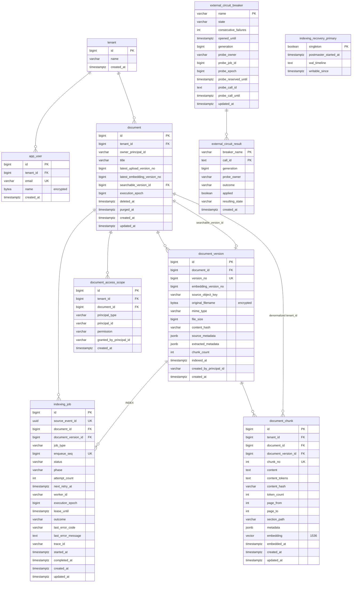

[한국어](SCHEMA.md) | **English**

# Database Schema

| Item              | Value                                               |
|-------------------|-------------------------------------------------|
| Base migration    | `V20261015_001__notify_indexing_jobs.sql`        |
| Last updated      | 2026-10-15                                      |
| Target DB         | PostgreSQL 17.8 (local) / Tmax OpenSQL v3.0 (dev) |

The schema is owned by the API server repository; the worker reads and writes it without running migrations.
State transitions were written by cross-checking the code of both repositories — server `ba08e4a`, worker `897b004`.

---

## 1. Overall structure

---

## 2. Tables

### 2.1 `tenant`

Tenant. The isolation unit for all data.

| Column       | Type           | Constraints        | Description |
|--------------|----------------|---------------------|-------|
| `id`         | `BIGINT`       | PK, identity        |       |
| `name`       | `VARCHAR(100)` | `NOT NULL`          |       |
| `created_at` | `TIMESTAMPTZ`  | `NOT NULL`, defaults to now |       |

### 2.2 `app_user`

User. Named `app_user` because `user` is a reserved word in PostgreSQL.

| Column       | Type           | Constraints                          | Description                    |
|--------------|----------------|---------------------------------------|-----------------------|
| `id`         | `BIGINT`       | PK, identity                          |                       |
| `tenant_id`  | `BIGINT`       | `NOT NULL`, FK → `tenant(id)`         |                       |
| `email`      | `VARCHAR(255)` | `NOT NULL`, `(tenant_id, email)` UK   | Plaintext. Used for the UNIQUE constraint and login lookups |
| `name`       | `BYTEA`        | `NOT NULL`                            | Subject to encryption |
| `created_at` | `TIMESTAMPTZ`  | `NOT NULL`, defaults to now           |                       |

### 2.3 `document`

Document. Holds a version counter, a deletion timestamp, and an execution number.

| Column                          | Type             | Constraints                                                   | Description                                          |
|---------------------------------|------------------|-----------------------------------------------------------------|---------------------------------------------|
| `id`                            | `BIGINT`         | PK, identity                                                    |                                             |
| `tenant_id`                     | `BIGINT`         | `NOT NULL`, FK → `tenant(id)`, `(id, tenant_id)` UK             | Target of composite FKs from child tables            |
| `owner_principal_id`            | `VARCHAR(255)`   | `NOT NULL`                                                      |                                             |
| `title`                         | `VARCHAR(255)`   | `NOT NULL`                                                      |                                             |
| `latest_upload_version_no`      | `BIGINT`         | `NOT NULL`, default `0`, `>= 0`                                  | The last `version_no` issued. Counter for numbering the next version |
| `latest_embedding_version_no`   | `BIGINT`         | `NOT NULL`, default `0`, `>= 0`, `<= latest_upload_version_no`   | The most recent `version_no` promoted to searchable. Metadata for responses |
| `searchable_version_id`         | `BIGINT`         | FK → `document_version(id, document_id)`                       | The version used for search                          |
| `execution_epoch`               | `BIGINT`         | `NOT NULL`, default `0`, `>= 0`                                  | Per-document execution number. Incremented each time a job of this document is claimed and never reset. Used to reject late writes from a previous worker |
| `deleted_at`                    | `TIMESTAMPTZ`    |                                                                  | Timestamp when deletion was requested                |
| `purged_at`                     | `TIMESTAMPTZ`    | value allowed only when `deleted_at IS NOT NULL`                | Timestamp when physical cleanup completed. Nothing writes it currently |
| `created_at` / `updated_at`     | `TIMESTAMPTZ`    | `NOT NULL`, defaults to now                                     |                                             |

### 2.4 `document_version`

Upload unit. Each upload of a document is one row.

| Column                      | Type              | Constraints                                                     | Description                |
|-----------------------------|-------------------|--------------------------------------------------------------------|-------------------|
| `id`                        | `BIGINT`          | PK, identity, `(id, document_id)` UK                               |                   |
| `document_id`               | `BIGINT`          | `NOT NULL`, FK → `document(id)`                                    |                   |
| `version_no`                | `BIGINT`          | `NOT NULL`, `> 0`, `(document_id, version_no)` UK                  | Sequence number within the document |
| `embedding_version_no`      | `BIGINT`          | `NOT NULL`, `> 0`                                                  | The API server fills it with the same value as `version_no`. Promotion is decided by `version_no` |
| `source_object_key`         | `VARCHAR(1024)`   | `NOT NULL`                                                         | Object storage key of the original file |
| `original_filename`         | `BYTEA`           | `NOT NULL`                                                         | Subject to encryption |
| `mime_type`                 | `VARCHAR(100)`    | `NOT NULL`                                                         |                   |
| `file_size`                 | `BIGINT`          | `NOT NULL`, `>= 0`                                                 | Bytes             |
| `content_hash`              | `VARCHAR(128)`    | `NOT NULL`                                                         |                   |
| `source_metadata`           | `JSONB`           |                                                                     | Metadata received together with the upload |
| `extracted_metadata`        | `JSONB`           |                                                                     | Metadata generated by AI |
| `chunk_count`                | `INTEGER`         | `NULL` or `>= 0`                                                   | Filled in by the worker when processing completes |
| `indexed_at`                | `TIMESTAMPTZ`     |                                                                     | Filled in by the worker together with `chunk_count` |
| `created_by_principal_id`   | `VARCHAR(255)`    | `NOT NULL`                                                         |                   |
| `created_at`                | `TIMESTAMPTZ`     | `NOT NULL`, defaults to now                                        |                   |

### 2.5 `document_chunk`

Search unit. Holds both the embedding and keyword tokens. `tenant_id` is a column denormalized down from `document`.

| Column                        | Type              | Constraints                                                    | Description                                          |
|-------------------------------|-------------------|--------------------------------------------------------------------|-----------------------------------------------|
| `id`                          | `BIGINT`          | PK, identity                                                        |                                               |
| `tenant_id`                   | `BIGINT`          | `NOT NULL`, `(document_id, tenant_id)` FK → `document`              |                                               |
| `document_id`                 | `BIGINT`          | `NOT NULL`                                                          |                                               |
| `document_version_id`         | `BIGINT`          | `NOT NULL`, `(document_version_id, document_id)` FK                 |                                               |
| `chunk_no`                    | `INTEGER`         | `NOT NULL`, `>= 0`, `(document_version_id, chunk_no)` UK            | Sequence number within the version                    |
| `content`                     | `TEXT`            | `NOT NULL`                                                          | Raw chunk text                                       |
| `content_tokens`              | `TEXT`            |                                                                      | Tokens normalized by Nori morphological analysis (space-separated). Excluded from keyword candidate lookup when `NULL` |
| `content_hash`                | `VARCHAR(128)`    | `NOT NULL`                                                          |                                               |
| `token_count`                 | `INTEGER`         | `NULL` or `>= 0`                                                    |                                               |
| `page_from` / `page_to`       | `INTEGER`         | if both are present, `page_from <= page_to`                        |                                               |
| `section_path`                | `VARCHAR(1024)`   |                                                                      |                                               |
| `metadata`                    | `JSONB`           |                                                                      |                                               |
| `embedding`                   | `VECTOR(1536)`    | `NOT NULL`                                                          | Target of the HNSW cosine index                       |
| `embedded_at`                 | `TIMESTAMPTZ`     | `NOT NULL`                                                          |                                               |
| `created_at` / `updated_at`   | `TIMESTAMPTZ`     | `NOT NULL`, defaults to now                                         |                                               |

### 2.6 `document_access_scope`

Document access permissions. Document lookup and search reference only this table.

| Column                      | Type             | Constraints                                                          | Description                               |
|-----------------------------|------------------|-------------------------------------------------------------------------|------------------------------------------|
| `id`                        | `BIGINT`         | PK, identity                                                            |                                          |
| `tenant_id`                 | `BIGINT`         | `NOT NULL`, `(document_id, tenant_id)` FK → `document`                  |                                          |
| `document_id`               | `BIGINT`         | `NOT NULL`                                                              |                                          |
| `principal_type`            | `VARCHAR(30)`    | `NOT NULL`, `USER` / `TENANT`                                           |                                          |
| `principal_id`              | `VARCHAR(255)`   | `NOT NULL`, `(document_id, principal_type, principal_id)` UK           | The string form of `tenant_id` when `TENANT` |
| `permission`                | `VARCHAR(20)`    | `NOT NULL`, default `READ`, `READ` / `WRITE` / `ADMIN`                  |                                          |
| `granted_by_principal_id`   | `VARCHAR(255)`   | `NOT NULL`                                                              |                                          |
| `created_at`                | `TIMESTAMPTZ`    | `NOT NULL`, defaults to now                                             |                                          |

### 2.7 `indexing_job`

The indexing job queue and its processing history. The API server and database triggers enqueue jobs; the worker claims and processes them.

| Column                        | Type             | Constraints                                         | Description                              |
|-------------------------------|------------------|-----------------------------------------------------|------------------------------------------|
| `id`                          | `BIGINT`         | PK, identity                                        |                                          |
| `source_event_id`             | `UUID`           | `NOT NULL`, UK                                      | Filled with `gen_random_uuid()` on enqueue |
| `document_id`                 | `BIGINT`         | `NOT NULL`, FK → `document(id)`                     |                                          |
| `document_version_id`         | `BIGINT`         | `(document_version_id, document_id)` FK             | Set for `INDEX`, `NULL` for `DELETE`     |
| `job_type`                    | `VARCHAR(20)`    | `NOT NULL`, default `INDEX`, `INDEX` / `DELETE`     | `INDEX`: build chunks and embeddings / `DELETE`: clean up chunks of a deleted document |
| `enqueue_seq`                 | `BIGINT`         | `NOT NULL`, identity, UK                            | Global enqueue order. Used for claim order and to detect an earlier job of the same document. Gaps may occur |
| `status`                      | `VARCHAR(30)`    | `NOT NULL`, one of the five values in section 3     | See section 3                            |
| `phase`                       | `VARCHAR(30)`    |                                                     | Current processing stage. `DOWNLOADING` / `PARSING` / `CHUNKING` / `EMBEDDING` |
| `attempt_count`               | `INTEGER`        | `NOT NULL`, default `0`, `>= 0`                     | Incremented on every claim               |
| `next_retry_at`               | `TIMESTAMPTZ`    |                                                     | When a `RETRY_WAIT` job becomes claimable again |
| `worker_id`                   | `VARCHAR(255)`   | set only while `PROCESSING`, otherwise `NULL`       | The worker holding the execution right   |
| `execution_epoch`             | `BIGINT`         | `NOT NULL`, default `0`, `>= 0`                     | Execution number copied from `document.execution_epoch` on claim. `0` before the first claim |
| `lease_until`                 | `TIMESTAMPTZ`    | set only while `PROCESSING`, otherwise `NULL`       | When the execution right expires. Extended by heartbeat |
| `outcome`                     | `VARCHAR(40)`    |                                                     | Reason for the end state. `INDEXED` / `DELETED` / `SKIPPED_DOCUMENT_DELETED` / `RETRY_SCHEDULED` / `FAILED_PROCESSING`. No CHECK because values may grow |
| `last_error_code`             | `VARCHAR(100)`   |                                                     | Failure code classified by the worker    |
| `last_error_message`          | `TEXT`           |                                                     |                                          |
| `trace_id`                    | `VARCHAR(255)`   |                                                     | Value passed via `SET LOCAL app.trace_id` in the transaction |
| `started_at`                  | `TIMESTAMPTZ`    |                                                     |                                          |
| `completed_at`                | `TIMESTAMPTZ`    |                                                     |                                          |
| `created_at` / `updated_at`   | `TIMESTAMPTZ`    | `NOT NULL`, defaults to now                         |                                          |

### 2.8 `external_circuit_breaker`

Circuit breaker state per external API (embedding). Multiple worker instances share the state through the database. The only row today is `embedding-api`.

| Column                   | Type             | Constraints                              | Description                                     |
|--------------------------|------------------|------------------------------------------|-------------------------------------------------|
| `name`                   | `VARCHAR(50)`    | PK                                       | Breaker name                                    |
| `state`                  | `VARCHAR(20)`    | `NOT NULL`, default `CLOSED`, `CLOSED` / `OPEN` / `HALF_OPEN` | See section 3                    |
| `consecutive_failures`   | `INTEGER`        | `NOT NULL`, default `0`, `>= 0`          | Consecutive transient failures. Reset to `0` on success |
| `opened_until`           | `TIMESTAMPTZ`    | `NOT NULL` when `OPEN`                   | Calls are blocked until this time               |
| `generation`             | `BIGINT`         | `NOT NULL`, default `0`, `>= 0`          | Incremented on every state change. Used to ignore results from an older generation |
| `probe_owner`            | `VARCHAR(100)`   | set only when `HALF_OPEN`                | Worker responsible for the probe call           |
| `probe_job_id`           | `BIGINT`         | set only when `HALF_OPEN`                | Job used for the probe call                     |
| `probe_epoch`            | `BIGINT`         | set only when `HALF_OPEN`, `>= 0`        | Execution number of that job                    |
| `probe_reserved_until`   | `TIMESTAMPTZ`    | set only when `HALF_OPEN`                | When the probe reservation expires              |
| `probe_call_id`          | `TEXT`           | set together with `probe_call_until`     | ID of the probe call in progress                |
| `probe_call_until`       | `TIMESTAMPTZ`    | set together with `probe_call_id`        | When the probe call in progress expires         |
| `updated_at`             | `TIMESTAMPTZ`    | `NOT NULL`, defaults to now              |                                                 |

### 2.9 `external_circuit_result`

Record of external API call results. Keyed by `(breaker_name, call_id)` so the same call result is never applied twice.

| Column              | Type             | Constraints                                                  | Description                     |
|---------------------|------------------|--------------------------------------------------------------|---------------------------------|
| `breaker_name`      | `VARCHAR(50)`    | PK, FK → `external_circuit_breaker(name)`                    |                                 |
| `call_id`           | `TEXT`           | PK                                                           | Call ID                         |
| `generation`        | `BIGINT`         | `NOT NULL`, `>= 0`                                           | Breaker generation at call time |
| `probe_owner`       | `VARCHAR(100)`   |                                                              |                                 |
| `outcome`           | `VARCHAR(20)`    | `NOT NULL`, `SUCCESS` / `FAILURE` / `RATE_LIMIT` / `PERMANENT` / `CONFIGURATION` | Call result |
| `applied`           | `BOOLEAN`        | `NOT NULL`                                                   | Whether it was applied to the breaker state |
| `resulting_state`   | `VARCHAR(20)`    | `NOT NULL`, `CLOSED` / `OPEN` / `HALF_OPEN`                  | Breaker state after applying    |
| `created_at`        | `TIMESTAMPTZ`    | `NOT NULL`, defaults to now                                  |                                 |

### 2.10 `indexing_recovery_primary`

Reference point for reclaiming expired jobs. Exactly one row exists. Right after a primary starts or is promoted, the previous primary's leases cannot be trusted, so reclaiming runs only when this row matches the current startup and timeline and 30 seconds have passed (section 7).

| Column                    | Type            | Constraints                          | Description                              |
|---------------------------|-----------------|--------------------------------------|------------------------------------------|
| `singleton`               | `BOOLEAN`       | PK, default `TRUE`, only `TRUE` allowed | Limits the table to one row            |
| `postmaster_started_at`   | `TIMESTAMPTZ`   | `NOT NULL`                           | `pg_postmaster_start_time()` when recorded |
| `wal_timeline`            | `TEXT`          | `NOT NULL`, 8 hex digits             | WAL timeline when recorded               |
| `writable_since`          | `TIMESTAMPTZ`   | `NOT NULL`                           | When the node became writable. Basis for the reclaim grace period |

---

## 3. Status values

### `indexing_job.status`

Enqueueing is done by database triggers and the API server; later transitions are done by the worker and the reclaim procedure.

| Value          | Meaning                                                    |
|----------------|------------------------------------------------------------|
| `PENDING`      | Waiting to be claimed                                      |
| `PROCESSING`   | Being processed by a worker holding the execution right (`worker_id`, `lease_until`) |
| `RETRY_WAIT`   | Waiting until `next_retry_at` after a transient failure    |
| `COMPLETED`    | Finished. The reason is in `outcome`                       |
| `FAILED`       | Final failure                                              |

| Transition                                       | Trigger                                                                 |
|--------------------------------------------------|-------------------------------------------------------------------------|
| (none) → `PENDING`                               | Version insert trigger (`INDEX`), document delete trigger (`DELETE`), manual reindex by the API server (`INDEX`) |
| `PENDING` / `RETRY_WAIT` → `PROCESSING`          | Worker claim. `RETRY_WAIT` only once `next_retry_at` has passed. Increments the document's `execution_epoch`, copies it to the job, and records `worker_id`, `lease_until`, and `attempt_count` |
| `PROCESSING` → `COMPLETED`                       | Processing finished. `INDEXED` for `INDEX`, `DELETED` for `DELETE`, `SKIPPED_DOCUMENT_DELETED` for an `INDEX` job of a deleted document |
| `PROCESSING` → `RETRY_WAIT`                      | Transient failure with attempts left. `outcome = 'RETRY_SCHEDULED'`      |
| `PROCESSING` → `FAILED`                          | Permanent failure or attempt limit (default 5) reached. `outcome = 'FAILED_PROCESSING'` |
| `PROCESSING` → `PENDING`                         | The reclaim procedure returns a job whose lease expired. Heartbeats and result writes from the previous worker are rejected afterwards |

- Claims pick the candidate with the smallest `enqueue_seq`, and a job is not claimed while an earlier unfinished job of the same document exists.
- A partial unique index allows only one `PENDING` / `PROCESSING` / `RETRY_WAIT` job per `document_version`.
- `FAILED` is never revived. A manual reindex enqueues a new job.
- Whenever a job becomes `PENDING` (enqueue, reclaim), a trigger wakes the worker with `pg_notify('indexing_job', '')` (section 7).

### `indexing_job.phase`

Each stage is recorded **just before entering** it.

`DOWNLOADING` → `PARSING` → `CHUNKING` → `EMBEDDING`

### `external_circuit_breaker.state`

| Value         | Meaning                                                    |
|---------------|------------------------------------------------------------|
| `CLOSED`      | Normal. Calls are allowed                                  |
| `OPEN`        | Stops `INDEX` claims and embedding calls until `opened_until`. `DELETE` jobs are still claimed |
| `HALF_OPEN`   | One worker takes the probe call (`probe_*`). Success closes the breaker; failure opens it again |

The breaker opens after consecutive transient failures. Billing quota exhaustion (429 `insufficient_quota`) and authentication or permission errors open it immediately regardless of the count.

---

## 4. Reference rules

- **Tenant isolation**: child tables reference `document` through a `(document_id, tenant_id)` composite FK. A document from another tenant cannot be attached using `document_id` alone.
- **Version consistency**: chunks and `INDEX` jobs use a `(document_version_id, document_id)` composite FK.
- **`DELETE` jobs**: `document_version_id` is `NULL`, so the composite FK is not checked; a direct FK to `document(id)` is added instead. The pairing of `job_type` and `document_version_id` is enforced by a CHECK.
- **`searchable_version_id`**: a reverse FK from `document` to `document_version`. Added with `ALTER TABLE` after `document_version` is created.

---

## 5. Write ownership

Two repositories and the database write to one schema. Which side writes each column differs, so it is summarized here.

| Target                                                                  | Writer     |
|-------------------------------------------------------------------------|------------|
| All migrations                                                          | API server |
| `tenant`, `app_user`, `document_access_scope`                           | API server |
| `document` creation, `title`, `latest_upload_version_no`, `deleted_at`  | API server |
| `document_version` insert (including `embedding_version_no`)            | API server |
| `indexing_job` insert (version insert, document delete)                 | DB trigger |
| `indexing_job` insert (manual reindex)                                  | API server |
| `indexing_job` status, execution-right, and result columns              | Worker     |
| `indexing_job` expired-lease reclaim (`PROCESSING` → `PENDING`)         | Reclaim procedure (pg_cron) |
| `document.execution_epoch`                                              | Worker (on claim) |
| All of `document_chunk`                                                 | Worker     |
| `document_version.chunk_count`, `indexed_at`                            | Worker     |
| `document.searchable_version_id`, `latest_embedding_version_no`         | Worker     |
| `external_circuit_breaker`, `external_circuit_result`                   | Worker     |
| `indexing_recovery_primary`                                             | `mark_indexing_recovery_primary()` (Patroni callback) |

Promotion rule: the worker promotes only when the candidate version's `version_no` is greater than that of the current `searchable_version_id`. Deleted documents (`deleted_at IS NOT NULL`) are excluded from promotion, so an old job that finishes late cannot roll the search version back. Saving chunks, completing the version, promotion, and completing the job happen in one transaction.

Deletion cleanup: when a document is deleted, a trigger enqueues a `DELETE` job, and the worker deletes the chunks in that job. There is no separate sweep.

---

## 6. Indexes

| Index                                    | Target                                                 | Purpose               |
|------------------------------------------|--------------------------------------------------------|-----------------------|
| `idx_document_tenant_active`             | `document (tenant_id, id) WHERE deleted_at IS NULL`    | Tenant document list  |
| `idx_document_pending_purge`             | `document (deleted_at) WHERE deleted_at IS NOT NULL AND purged_at IS NULL` | Deletion cleanup scan. Not used currently |
| `idx_document_version_document`          | `document_version (document_id, version_no DESC)`      | Version list          |
| `uq_indexing_job_active_version`         | `indexing_job (document_version_id) WHERE status IN ('PENDING','PROCESSING','RETRY_WAIT')` | Prevent duplicate in-progress jobs (UNIQUE) |
| `uq_indexing_job_enqueue_seq`            | `indexing_job (enqueue_seq)`                            | Unique enqueue order (UNIQUE) |
| `idx_indexing_job_claim_order`           | `indexing_job (enqueue_seq) WHERE status IN ('PENDING','RETRY_WAIT')` | Claim candidates in enqueue order |
| `idx_indexing_job_document_order`        | `indexing_job (document_id, enqueue_seq) WHERE status IN ('PENDING','PROCESSING','RETRY_WAIT')` | Check for an earlier unfinished job of the same document |
| `idx_indexing_job_retry_due`             | `indexing_job (next_retry_at) WHERE status = 'RETRY_WAIT'` | Jobs whose retry time has come |
| `idx_indexing_job_expired_lease`         | `indexing_job (lease_until) WHERE status = 'PROCESSING'` | Reclaim expired leases |
| `idx_indexing_job_retry`                 | `indexing_job (status, next_retry_at) WHERE status IN ('PENDING','RETRY_WAIT')` | Retry candidates |
| `idx_indexing_job_version`               | `indexing_job (document_version_id, created_at DESC)`   | Indexing history per version |
| `idx_circuit_result_generation`          | `external_circuit_result (breaker_name, generation)`    | Call results per generation |
| `idx_chunk_document_version`             | `document_chunk (document_version_id, chunk_no)`        | Chunks per version    |
| `idx_document_chunk_embedding_hnsw`      | `document_chunk USING hnsw (embedding vector_cosine_ops)`, `m = 16`, `ef_construction = 64` | Vector similarity search |
| `idx_document_chunk_content_tokens_tsv`  | `document_chunk USING GIN (to_tsvector('simple', content_tokens))` | Keyword candidate retrieval (BM25 path) |
| `idx_document_chunk_content_tsv`         | `document_chunk USING GIN (to_tsvector('simple', content))` | Keyword search on raw text (fallback path) |
| `idx_access_scope_principal`             | `document_access_scope (tenant_id, principal_type, principal_id, document_id)` | Documents a principal can access |

---

## 7. Triggers, procedures, and scheduled jobs

### Triggers

| Trigger                              | When                                                         | Action                                     |
|--------------------------------------|--------------------------------------------------------------|--------------------------------------------|
| `trg_document_version_enqueue_job`   | `AFTER INSERT ON document_version`                           | Locks the document row, then enqueues an `INDEX` job as `PENDING`. If the version already has an unfinished job, the unique violation fails the request transaction |
| `trg_document_deleted_enqueue_job`   | `AFTER UPDATE ON document` (only when `deleted_at` goes from `NULL` to a value) | Enqueues a `DELETE` job as `PENDING` |
| `trg_indexing_job_notify_insert`     | `AFTER INSERT ON indexing_job` (`status = 'PENDING'`)          | `pg_notify('indexing_job', '')`             |
| `trg_indexing_job_notify_pending`    | `AFTER UPDATE OF status ON indexing_job` (another value → `PENDING`) | `pg_notify('indexing_job', '')`       |

A notification is a wake-up signal delivered after commit. The payload is empty so that multiple notifications in one transaction collapse into one, and the worker picks the actual targets with its claim conditions. Notifications can be lost and there is none for a `RETRY_WAIT` retry time, so the worker also polls.

### Procedures and scheduled jobs

| Name                                         | Run by                   | Action                                                       |
|----------------------------------------------|--------------------------|--------------------------------------------------------------|
| `reclaim_expired_indexing_jobs(batch_size)`  | pg_cron `aidocs-reclaim-expired-indexing-jobs` (every 30 seconds, 100 per run) | Returns `PROCESSING` jobs whose `lease_until` has passed to `PENDING` and clears `worker_id`, `lease_until`, and `next_retry_at`. Does nothing on a standby or read-only node, when `indexing_recovery_primary` does not match the current startup and timeline, or within 30 seconds of becoming writable |
| `mark_indexing_recovery_primary()`           | Patroni `on_start` / `on_restart` / `on_role_change` callbacks | Records the current startup time, WAL timeline, and writable time in `indexing_recovery_primary`. A repeated call for the same startup and timeline does not restart the grace period |

pg_cron must be installed outside Flyway. The migration only registers the job with the installed pg_cron.

---

## 8. Encryption

`app_user.name` and `document_version.original_filename` are stored as `BYTEA` and encrypted/decrypted through functions at query time.

| Function               | Description                                                                                        |
|-------------------------|-----------------------------------------------------------------------------------------------------|
| `app_encrypt(bytea)`   | Encrypts using the `app.encryption_key` session setting. The algorithm is specified via `app.encryption_cipher` (default `aria256`) |
| `app_decrypt(bytea)`   | Decrypts using the `app.encryption_key` session setting                                              |

`app_user.email` is excluded from encryption since it's used for the UNIQUE constraint and login lookups.

The schema only creates the `vector` extension. `opencrypto` is not installed; since the column type doesn't depend on the extension, schema creation still succeeds even on a local environment without it.
