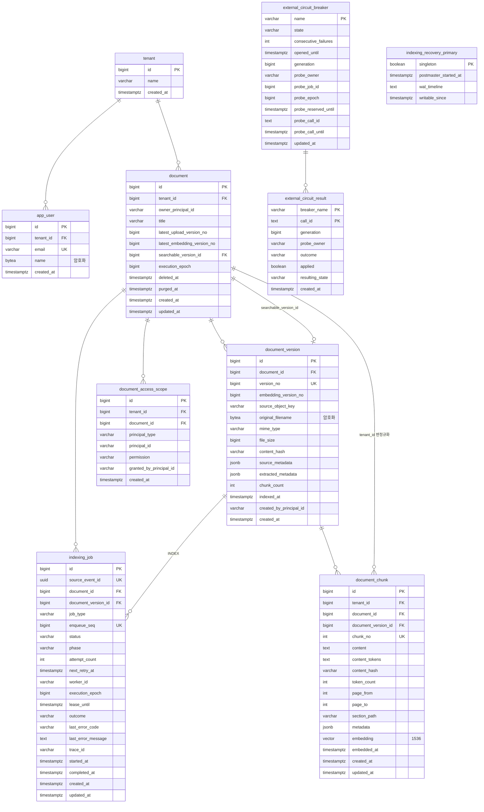

**한국어** | [English](SCHEMA.en.md)

# 데이터베이스 스키마

| 항목        | 값                                               |
|-----------|-------------------------------------------------|
| 기준 마이그레이션 | `V20261015_001__notify_indexing_jobs.sql`        |
| 최종 수정     | 2026-10-15                                      |
| 대상 DB     | PostgreSQL 17.8 (local) / Tmax OpenSQL v3.0 (dev) |

스키마는 API 서버 저장소가 소유하고, Worker 는 마이그레이션 없이 읽고 씁니다.
상태 전이는 두 저장소의 코드를 함께 확인해 적었습니다 — server `ba08e4a`, worker `897b004`.

---

## 1. 전체 구조

---

## 2. 테이블

### 2.1 `tenant`

테넌트. 모든 데이터의 격리 단위입니다.

| 컬럼           | 타입             | 제약                | 설명    |
|--------------|----------------|-------------------|-------|
| `id`         | `BIGINT`       | PK, identity      |       |
| `name`       | `VARCHAR(100)` | `NOT NULL`        |       |
| `created_at` | `TIMESTAMPTZ`  | `NOT NULL`, 기본 현재 |       |

### 2.2 `app_user`

사용자. `user` 는 PostgreSQL 예약어라 `app_user` 를 씁니다.

| 컬럼           | 타입             | 제약                                  | 설명                    |
|--------------|----------------|-------------------------------------|-----------------------|
| `id`         | `BIGINT`       | PK, identity                        |                       |
| `tenant_id`  | `BIGINT`       | `NOT NULL`, FK → `tenant(id)`       |                       |
| `email`      | `VARCHAR(255)` | `NOT NULL`, `(tenant_id, email)` UK | 평문. UNIQUE 제약과 로그인 조회용 |
| `name`       | `BYTEA`        | `NOT NULL`                          | 암호화 대상                |
| `created_at` | `TIMESTAMPTZ`  | `NOT NULL`, 기본 현재                   |                       |

### 2.3 `document`

문서. 버전 카운터, 삭제 시각, 실행 번호를 가집니다.

| 컬럼                            | 타입             | 제약                                                    | 설명                                          |
|-------------------------------|----------------|-------------------------------------------------------|---------------------------------------------|
| `id`                          | `BIGINT`       | PK, identity                                          |                                             |
| `tenant_id`                   | `BIGINT`       | `NOT NULL`, FK → `tenant(id)`, `(id, tenant_id)` UK   | 하위 테이블의 복합 FK 대상                            |
| `owner_principal_id`          | `VARCHAR(255)` | `NOT NULL`                                            |                                             |
| `title`                       | `VARCHAR(255)` | `NOT NULL`                                            |                                             |
| `latest_upload_version_no`    | `BIGINT`       | `NOT NULL`, 기본 `0`, `>= 0`                            | 마지막으로 발급된 `version_no`. 다음 버전 채번 카운터        |
| `latest_embedding_version_no` | `BIGINT`       | `NOT NULL`, 기본 `0`, `>= 0`, `<= latest_upload_version_no` | 검색 대상으로 승격된 가장 최신 `version_no`. 응답용 메타데이터입니다 |
| `searchable_version_id`       | `BIGINT`       | FK → `document_version(id, document_id)`              | 검색 대상 버전                                    |
| `execution_epoch`             | `BIGINT`       | `NOT NULL`, 기본 `0`, `>= 0`                            | 문서 단위 실행 번호. 이 문서의 Job 을 선점할 때마다 1 씩 오르고 되돌아가지 않습니다. 이전 Worker 의 늦은 쓰기를 거절하는 데 씁니다 |
| `deleted_at`                  | `TIMESTAMPTZ`  |                                                       | 삭제 요청 시각                                    |
| `purged_at`                   | `TIMESTAMPTZ`  | `deleted_at IS NOT NULL` 일 때만 값 허용                     | 물리 정리 완료 시각. 현재 채우는 곳은 없습니다                 |
| `created_at` / `updated_at`   | `TIMESTAMPTZ`  | `NOT NULL`, 기본 현재                                     |                                             |

### 2.4 `document_version`

업로드 단위. 한 문서의 각 업로드가 한 행입니다.

| 컬럼                        | 타입              | 제약                                                           | 설명                |
|---------------------------|-----------------|--------------------------------------------------------------|-------------------|
| `id`                      | `BIGINT`        | PK, identity, `(id, document_id)` UK                         |                   |
| `document_id`             | `BIGINT`        | `NOT NULL`, FK → `document(id)`                              |                   |
| `version_no`              | `BIGINT`        | `NOT NULL`, `> 0`, `(document_id, version_no)` UK            | 문서 내 순번           |
| `embedding_version_no`    | `BIGINT`        | `NOT NULL`, `> 0`                                            | API 서버가 `version_no` 와 같은 값으로 채웁니다. 승격 판단에는 `version_no` 를 씁니다 |
| `source_object_key`       | `VARCHAR(1024)` | `NOT NULL`                                                   | 원본 오브젝트 스토리지 키    |
| `original_filename`       | `BYTEA`         | `NOT NULL`                                                   | 암호화 대상            |
| `mime_type`               | `VARCHAR(100)`  | `NOT NULL`                                                   |                   |
| `file_size`               | `BIGINT`        | `NOT NULL`, `>= 0`                                           | 바이트               |
| `content_hash`            | `VARCHAR(128)`  | `NOT NULL`                                                   |                   |
| `source_metadata`         | `JSONB`         |                                                              | 업로드 시 함께 받은 메타데이터 |
| `extracted_metadata`      | `JSONB`         |                                                              | AI 가 생성한 메타데이터    |
| `chunk_count`             | `INTEGER`       | `NULL` 이거나 `>= 0`                                            | Worker 가 처리 완료 시 채웁니다 |
| `indexed_at`              | `TIMESTAMPTZ`   |                                                              | Worker 가 `chunk_count` 와 함께 채웁니다 |
| `created_by_principal_id` | `VARCHAR(255)`  | `NOT NULL`                                                   |                   |
| `created_at`              | `TIMESTAMPTZ`   | `NOT NULL`, 기본 현재                                            |                   |

### 2.5 `document_chunk`

검색 단위. 임베딩과 키워드 토큰을 함께 가집니다. `tenant_id` 는 `document` 에서 내려온 반정규화 컬럼입니다.

| 컬럼                          | 타입              | 제약                                                        | 설명                                            |
|-----------------------------|-----------------|-----------------------------------------------------------|-----------------------------------------------|
| `id`                        | `BIGINT`        | PK, identity                                              |                                               |
| `tenant_id`                 | `BIGINT`        | `NOT NULL`, `(document_id, tenant_id)` FK → `document`    |                                               |
| `document_id`               | `BIGINT`        | `NOT NULL`                                                |                                               |
| `document_version_id`       | `BIGINT`        | `NOT NULL`, `(document_version_id, document_id)` FK       |                                               |
| `chunk_no`                  | `INTEGER`       | `NOT NULL`, `>= 0`, `(document_version_id, chunk_no)` UK  | 버전 내 순번                                       |
| `content`                   | `TEXT`          | `NOT NULL`                                                | 청크 원문                                         |
| `content_tokens`            | `TEXT`          |                                                           | Nori 형태소 분석으로 정규화한 토큰(공백 구분). `NULL` 이면 키워드 후보 조회에서 제외 |
| `content_hash`              | `VARCHAR(128)`  | `NOT NULL`                                                |                                               |
| `token_count`               | `INTEGER`       | `NULL` 이거나 `>= 0`                                         |                                               |
| `page_from` / `page_to`     | `INTEGER`       | 둘 다 있으면 `page_from <= page_to`                            |                                               |
| `section_path`              | `VARCHAR(1024)` |                                                           |                                               |
| `metadata`                  | `JSONB`         |                                                           |                                               |
| `embedding`                 | `VECTOR(1536)`  | `NOT NULL`                                                | HNSW 코사인 인덱스 대상                               |
| `embedded_at`               | `TIMESTAMPTZ`   | `NOT NULL`                                                |                                               |
| `created_at` / `updated_at` | `TIMESTAMPTZ`   | `NOT NULL`, 기본 현재                                         |                                               |

### 2.6 `document_access_scope`

문서 접근 권한. 문서 조회와 검색은 이 테이블만 참조합니다.

| 컬럼                        | 타입             | 제약                                                                  | 설명                                       |
|---------------------------|----------------|---------------------------------------------------------------------|------------------------------------------|
| `id`                      | `BIGINT`       | PK, identity                                                        |                                          |
| `tenant_id`               | `BIGINT`       | `NOT NULL`, `(document_id, tenant_id)` FK → `document`              |                                          |
| `document_id`             | `BIGINT`       | `NOT NULL`                                                          |                                          |
| `principal_type`          | `VARCHAR(30)`  | `NOT NULL`, `USER` / `TENANT`                                       |                                          |
| `principal_id`            | `VARCHAR(255)` | `NOT NULL`, `(document_id, principal_type, principal_id)` UK        | `TENANT` 면 `tenant_id` 의 문자열              |
| `permission`              | `VARCHAR(20)`  | `NOT NULL`, 기본 `READ`, `READ` / `WRITE` / `ADMIN`                   |                                          |
| `granted_by_principal_id` | `VARCHAR(255)` | `NOT NULL`                                                          |                                          |
| `created_at`              | `TIMESTAMPTZ`  | `NOT NULL`, 기본 현재                                                   |                                          |

### 2.7 `indexing_job`

인덱싱 작업 큐이자 처리 이력. API 서버와 DB 트리거가 등록하고 Worker 가 선점해 처리합니다.

| 컬럼                          | 타입             | 제약                                                  | 설명                              |
|-----------------------------|----------------|-----------------------------------------------------|---------------------------------|
| `id`                        | `BIGINT`       | PK, identity                                        |                                 |
| `source_event_id`           | `UUID`         | `NOT NULL`, UK                                      | 등록 시 `gen_random_uuid()` 로 채웁니다 |
| `document_id`               | `BIGINT`       | `NOT NULL`, FK → `document(id)`                     |                                 |
| `document_version_id`       | `BIGINT`       | `(document_version_id, document_id)` FK             | `INDEX` 는 값을 가지고 `DELETE` 는 `NULL` |
| `job_type`                  | `VARCHAR(20)`  | `NOT NULL`, 기본 `INDEX`, `INDEX` / `DELETE`        | `INDEX`: 청크·임베딩 생성 / `DELETE`: 삭제된 문서의 청크 정리 |
| `enqueue_seq`               | `BIGINT`       | `NOT NULL`, identity, UK                            | 전역 등록 순서. 선점 순서와 같은 문서의 선행 Job 판단에 씁니다. 빈 번호가 생길 수 있습니다 |
| `status`                    | `VARCHAR(30)`  | `NOT NULL`, 3장의 다섯 값                                | 3장 참고                           |
| `phase`                     | `VARCHAR(30)`  |                                                     | 현재 처리 단계. `DOWNLOADING` / `PARSING` / `CHUNKING` / `EMBEDDING` |
| `attempt_count`             | `INTEGER`      | `NOT NULL`, 기본 `0`, `>= 0`                          | 선점할 때마다 1 씩 오릅니다                |
| `next_retry_at`             | `TIMESTAMPTZ`  |                                                     | `RETRY_WAIT` 이 다시 선점 가능해지는 시각     |
| `worker_id`                 | `VARCHAR(255)` | `PROCESSING` 일 때만 값, 그 밖에는 `NULL`                  | 실행권을 가진 Worker                   |
| `execution_epoch`           | `BIGINT`       | `NOT NULL`, 기본 `0`, `>= 0`                          | 선점 시 `document.execution_epoch` 에서 받은 실행 번호. 선점 전에는 `0` |
| `lease_until`               | `TIMESTAMPTZ`  | `PROCESSING` 일 때만 값, 그 밖에는 `NULL`                  | 실행권 만료 시각. heartbeat 로 연장합니다    |
| `outcome`                   | `VARCHAR(40)`  |                                                     | 종결 사유. `INDEXED` / `DELETED` / `SKIPPED_DOCUMENT_DELETED` / `RETRY_SCHEDULED` / `FAILED_PROCESSING`. 값이 늘 수 있어 CHECK 를 두지 않습니다 |
| `last_error_code`           | `VARCHAR(100)` |                                                     | Worker 가 분류한 실패 코드               |
| `last_error_message`        | `TEXT`         |                                                     |                                 |
| `trace_id`                  | `VARCHAR(255)` |                                                     | 트랜잭션에서 `SET LOCAL app.trace_id` 로 넘긴 값 |
| `started_at`                | `TIMESTAMPTZ`  |                                                     |                                 |
| `completed_at`              | `TIMESTAMPTZ`  |                                                     |                                 |
| `created_at` / `updated_at` | `TIMESTAMPTZ`  | `NOT NULL`, 기본 현재                                   |                                 |

### 2.8 `external_circuit_breaker`

외부 API(임베딩)별 서킷 브레이커 상태. 여러 Worker 인스턴스가 DB 로 상태를 공유합니다. 현재 행 이름은 `embedding-api` 하나입니다.

| 컬럼                     | 타입             | 제약                              | 설명                                     |
|------------------------|----------------|---------------------------------|----------------------------------------|
| `name`                 | `VARCHAR(50)`  | PK                              | 브레이커 이름                                |
| `state`                | `VARCHAR(20)`  | `NOT NULL`, 기본 `CLOSED`, `CLOSED` / `OPEN` / `HALF_OPEN` | 3장 참고                                  |
| `consecutive_failures` | `INTEGER`      | `NOT NULL`, 기본 `0`, `>= 0`      | 연속 일시 실패 수. 성공하면 `0`                    |
| `opened_until`         | `TIMESTAMPTZ`  | `OPEN` 이면 `NOT NULL`             | 이 시각까지 호출을 막습니다                         |
| `generation`           | `BIGINT`       | `NOT NULL`, 기본 `0`, `>= 0`      | 상태가 바뀔 때마다 오르는 세대 번호. 지난 세대의 결과를 무시하는 데 씁니다 |
| `probe_owner`          | `VARCHAR(100)` | `HALF_OPEN` 일 때만 값               | 시험 호출을 맡은 Worker                         |
| `probe_job_id`         | `BIGINT`       | `HALF_OPEN` 일 때만 값               | 시험 호출에 쓰는 Job                           |
| `probe_epoch`          | `BIGINT`       | `HALF_OPEN` 일 때만 값, `>= 0`      | 그 Job 의 실행 번호                           |
| `probe_reserved_until` | `TIMESTAMPTZ`  | `HALF_OPEN` 일 때만 값               | 시험 호출 예약 만료 시각                          |
| `probe_call_id`        | `TEXT`         | `probe_call_until` 과 함께 채움       | 진행 중인 시험 호출 ID                          |
| `probe_call_until`     | `TIMESTAMPTZ`  | `probe_call_id` 와 함께 채움         | 진행 중인 시험 호출 만료 시각                       |
| `updated_at`           | `TIMESTAMPTZ`  | `NOT NULL`, 기본 현재                 |                                        |

### 2.9 `external_circuit_result`

외부 API 호출 결과 기록. 같은 호출 결과를 두 번 반영하지 않도록 `(breaker_name, call_id)` 로 구분합니다.

| 컬럼                | 타입             | 제약                                                           | 설명                       |
|-------------------|----------------|--------------------------------------------------------------|--------------------------|
| `breaker_name`    | `VARCHAR(50)`  | PK, FK → `external_circuit_breaker(name)`                     |                          |
| `call_id`         | `TEXT`         | PK                                                           | 호출 ID                    |
| `generation`      | `BIGINT`       | `NOT NULL`, `>= 0`                                           | 호출 시점의 브레이커 세대           |
| `probe_owner`     | `VARCHAR(100)` |                                                              |                          |
| `outcome`         | `VARCHAR(20)`  | `NOT NULL`, `SUCCESS` / `FAILURE` / `RATE_LIMIT` / `PERMANENT` / `CONFIGURATION` | 호출 결과                    |
| `applied`         | `BOOLEAN`      | `NOT NULL`                                                   | 브레이커 상태에 반영됐는지            |
| `resulting_state` | `VARCHAR(20)`  | `NOT NULL`, `CLOSED` / `OPEN` / `HALF_OPEN`                  | 반영 뒤 브레이커 상태              |
| `created_at`      | `TIMESTAMPTZ`  | `NOT NULL`, 기본 현재                                            |                          |

### 2.10 `indexing_recovery_primary`

만료 Job 회수의 기준 시각. 행은 하나만 존재합니다. Primary 가 기동하거나 승격된 직후에는 이전 Primary 의 lease 를 믿을 수 없으므로, 이 행이 현재 기동·타임라인과 맞고 30초가 지난 뒤에만 회수합니다(7장).

| 컬럼                      | 타입            | 제약                              | 설명                                |
|-------------------------|---------------|---------------------------------|-----------------------------------|
| `singleton`             | `BOOLEAN`     | PK, 기본 `TRUE`, `TRUE` 만 허용       | 행을 하나로 제한합니다                       |
| `postmaster_started_at` | `TIMESTAMPTZ` | `NOT NULL`                      | 기록 당시 `pg_postmaster_start_time()` |
| `wal_timeline`          | `TEXT`        | `NOT NULL`, 16진수 8자리             | 기록 당시 WAL 타임라인                     |
| `writable_since`        | `TIMESTAMPTZ` | `NOT NULL`                      | 쓰기 가능해진 시각. 회수 유예의 기준                |

---

## 3. 상태값

### `indexing_job.status`

등록은 DB 트리거와 API 서버가, 이후 전이는 Worker 와 회수 프로시저가 합니다.

| 값            | 의미                                                  |
|--------------|-----------------------------------------------------|
| `PENDING`    | 선점 대기                                               |
| `PROCESSING` | Worker 가 실행권(`worker_id`, `lease_until`)을 가지고 처리 중   |
| `RETRY_WAIT` | 일시 실패 후 `next_retry_at` 까지 대기                        |
| `COMPLETED`  | 종결. 사유는 `outcome`                                    |
| `FAILED`     | 최종 실패                                               |

| 전이                                             | 계기                                                                    |
|------------------------------------------------|-----------------------------------------------------------------------|
| (없음) → `PENDING`                               | 버전 저장 트리거(`INDEX`), 문서 삭제 트리거(`DELETE`), API 서버의 수동 재인덱싱(`INDEX`) |
| `PENDING` / `RETRY_WAIT` → `PROCESSING`        | Worker 선점. `RETRY_WAIT` 은 `next_retry_at` 이 지난 것만 대상입니다. 문서 `execution_epoch` 를 올려 Job 에 복사하고 `worker_id`·`lease_until`·`attempt_count` 를 기록합니다 |
| `PROCESSING` → `COMPLETED`                     | 처리 완료. `INDEX` 는 `INDEXED`, `DELETE` 는 `DELETED`, 삭제된 문서의 `INDEX` 는 `SKIPPED_DOCUMENT_DELETED` |
| `PROCESSING` → `RETRY_WAIT`                    | 일시 실패이고 시도 횟수가 남았을 때. `outcome = 'RETRY_SCHEDULED'`              |
| `PROCESSING` → `FAILED`                        | 영구 실패이거나 시도 한도(기본 5회) 소진. `outcome = 'FAILED_PROCESSING'`         |
| `PROCESSING` → `PENDING`                       | lease 가 만료된 Job 을 회수 프로시저가 되돌립니다. 이전 Worker 의 heartbeat·결과 쓰기는 이후 거절됩니다 |

- 선점은 `enqueue_seq` 가 가장 작은 후보부터 하며, 같은 문서에 앞선 미종결 Job 이 있으면 뒤의 Job 은 선점하지 않습니다.
- 한 `document_version` 에 `PENDING` / `PROCESSING` / `RETRY_WAIT` 인 Job 은 부분 유니크 인덱스로 하나만 존재합니다.
- `FAILED` 는 되살리지 않습니다. 수동 재인덱싱은 새 Job 을 등록합니다.
- `PENDING` 이 되는 순간(등록, 회수) 트리거가 `pg_notify('indexing_job', '')` 로 Worker 를 깨웁니다(7장).

### `indexing_job.phase`

처리 단계는 각 단계에 **진입하기 직전에** 기록합니다.

`DOWNLOADING` → `PARSING` → `CHUNKING` → `EMBEDDING`

### `external_circuit_breaker.state`

| 값           | 의미                                                       |
|-------------|----------------------------------------------------------|
| `CLOSED`    | 정상. 호출을 허용합니다                                            |
| `OPEN`      | `opened_until` 까지 `INDEX` 선점과 임베딩 호출을 멈춥니다. `DELETE` 는 계속 선점합니다 |
| `HALF_OPEN` | Worker 하나가 시험 호출을 맡습니다(`probe_*`). 성공하면 `CLOSED`, 실패하면 다시 `OPEN` |

연속 일시 실패가 쌓이면 `OPEN` 이 됩니다. 결제 한도 초과(429 `insufficient_quota`)와 인증·권한 오류는 횟수와 관계없이 바로 엽니다.

---

## 4. 참조 규칙

- **테넌트 격리**: 하위 테이블은 `(document_id, tenant_id)` 복합 FK 로 `document` 를 참조합니다. `document_id` 만으로는 다른 테넌트의 문서를 붙일 수 없습니다.
- **버전 정합**: 청크와 `INDEX` Job 은 `(document_version_id, document_id)` 복합 FK 를 씁니다.
- **`DELETE` Job**: `document_version_id` 가 `NULL` 이라 복합 FK 가 검사되지 않으므로 `document(id)` 에 직접 FK 를 겁니다. `job_type` 과 `document_version_id` 의 짝은 CHECK 로 강제합니다.
- **`searchable_version_id`**: `document` → `document_version` 방향의 역참조 FK 입니다. `document_version` 생성 후 `ALTER TABLE` 로 추가합니다.

---

## 5. 쓰기 소유권

한 스키마를 두 저장소와 DB 가 함께 씁니다. 컬럼별로 쓰는 쪽이 갈리므로 정리해 둡니다.

| 대상                                                                    | 쓰는 쪽    |
|-----------------------------------------------------------------------|---------|
| 마이그레이션 전체                                                             | API 서버  |
| `tenant`, `app_user`, `document_access_scope`                         | API 서버  |
| `document` 생성, `title`, `latest_upload_version_no`, `deleted_at`       | API 서버  |
| `document_version` 삽입 (`embedding_version_no` 포함)                      | API 서버  |
| `indexing_job` 삽입 (버전 저장·문서 삭제)                                      | DB 트리거  |
| `indexing_job` 삽입 (수동 재인덱싱)                                          | API 서버  |
| `indexing_job` 상태·실행권·결과 컬럼                                          | Worker  |
| `indexing_job` 만료 lease 회수 (`PROCESSING` → `PENDING`)                  | 회수 프로시저 (pg_cron) |
| `document.execution_epoch`                                            | Worker (선점 시) |
| `document_chunk` 전체                                                   | Worker  |
| `document_version.chunk_count`, `indexed_at`                          | Worker  |
| `document.searchable_version_id`, `latest_embedding_version_no`       | Worker  |
| `external_circuit_breaker`, `external_circuit_result`                 | Worker  |
| `indexing_recovery_primary`                                           | `mark_indexing_recovery_primary()` (Patroni 콜백) |

승격 규칙: Worker 는 후보 버전의 `version_no` 가 현재 `searchable_version_id` 의 그것보다 클 때만 승격합니다. 삭제된 문서(`deleted_at IS NOT NULL`)는 승격 대상에서 빠지므로, 늦게 끝난 옛 Job 이 검색 버전을 되돌리지 못합니다. 청크 저장·버전 완료·승격·Job 완료는 한 트랜잭션입니다.

삭제 정리: 문서가 삭제되면 트리거가 `DELETE` Job 을 등록하고, Worker 가 그 Job 에서 청크를 지웁니다. 별도 스윕은 없습니다.

---

## 6. 인덱스

| 인덱스                                    | 대상                                                   | 용도                    |
|----------------------------------------|------------------------------------------------------|-----------------------|
| `idx_document_tenant_active`           | `document (tenant_id, id) WHERE deleted_at IS NULL`   | 테넌트 문서 목록             |
| `idx_document_pending_purge`           | `document (deleted_at) WHERE deleted_at IS NOT NULL AND purged_at IS NULL` | 삭제 정리 스캔. 현재 쓰는 곳은 없습니다  |
| `idx_document_version_document`        | `document_version (document_id, version_no DESC)`     | 버전 목록                 |
| `uq_indexing_job_active_version`       | `indexing_job (document_version_id) WHERE status IN ('PENDING','PROCESSING','RETRY_WAIT')` | 진행 중 Job 중복 방지 (UNIQUE) |
| `uq_indexing_job_enqueue_seq`          | `indexing_job (enqueue_seq)`                           | 등록 순서 유일성 (UNIQUE)     |
| `idx_indexing_job_claim_order`         | `indexing_job (enqueue_seq) WHERE status IN ('PENDING','RETRY_WAIT')` | 선점 후보를 등록 순서대로 조회     |
| `idx_indexing_job_document_order`      | `indexing_job (document_id, enqueue_seq) WHERE status IN ('PENDING','PROCESSING','RETRY_WAIT')` | 같은 문서의 선행 미종결 Job 확인   |
| `idx_indexing_job_retry_due`           | `indexing_job (next_retry_at) WHERE status = 'RETRY_WAIT'` | 재시도 시각이 된 Job 조회      |
| `idx_indexing_job_expired_lease`       | `indexing_job (lease_until) WHERE status = 'PROCESSING'` | 만료 lease 회수           |
| `idx_indexing_job_retry`               | `indexing_job (status, next_retry_at) WHERE status IN ('PENDING','RETRY_WAIT')` | 재시도 대상 조회             |
| `idx_indexing_job_version`             | `indexing_job (document_version_id, created_at DESC)`  | 버전별 인덱싱 이력            |
| `idx_circuit_result_generation`        | `external_circuit_result (breaker_name, generation)`   | 세대별 호출 결과 조회          |
| `idx_chunk_document_version`           | `document_chunk (document_version_id, chunk_no)`       | 버전별 청크 조회             |
| `idx_document_chunk_embedding_hnsw`    | `document_chunk USING hnsw (embedding vector_cosine_ops)`, `m = 16`, `ef_construction = 64` | 벡터 유사도 검색             |
| `idx_document_chunk_content_tokens_tsv` | `document_chunk USING GIN (to_tsvector('simple', content_tokens))` | 키워드 후보 회수 (BM25 경로)   |
| `idx_document_chunk_content_tsv`       | `document_chunk USING GIN (to_tsvector('simple', content))` | 원문 기준 키워드 검색 (대체 경로)  |
| `idx_access_scope_principal`           | `document_access_scope (tenant_id, principal_type, principal_id, document_id)` | 권한 있는 문서 조회           |

---

## 7. 트리거·프로시저·예약 작업

### 트리거

| 트리거                                | 시점                                                         | 동작                                         |
|------------------------------------|------------------------------------------------------------|--------------------------------------------|
| `trg_document_version_enqueue_job` | `AFTER INSERT ON document_version`                         | 문서 행을 잠근 뒤 `INDEX` Job 을 `PENDING` 으로 등록. 같은 버전에 미종결 Job 이 있으면 유니크 위반으로 요청 트랜잭션을 실패시킵니다 |
| `trg_document_deleted_enqueue_job` | `AFTER UPDATE ON document` (`deleted_at` 이 `NULL` → 값일 때만) | `DELETE` Job 을 `PENDING` 으로 등록              |
| `trg_indexing_job_notify_insert`   | `AFTER INSERT ON indexing_job` (`status = 'PENDING'`)        | `pg_notify('indexing_job', '')`             |
| `trg_indexing_job_notify_pending`  | `AFTER UPDATE OF status ON indexing_job` (다른 값 → `PENDING`) | `pg_notify('indexing_job', '')`             |

알림은 커밋 뒤에 전달되는 "깨어나라" 신호입니다. payload 는 비워 같은 트랜잭션의 여러 알림을 하나로 합치고, 실제 처리 대상은 Worker 가 선점 조건으로 고릅니다. 알림은 유실될 수 있고 `RETRY_WAIT` 의 재시도 시각에는 알림이 없으므로 Worker 는 폴링도 함께 합니다.

### 프로시저와 예약 작업

| 이름                                         | 실행 주체                    | 동작                                                         |
|--------------------------------------------|--------------------------|------------------------------------------------------------|
| `reclaim_expired_indexing_jobs(batch_size)` | pg_cron `aidocs-reclaim-expired-indexing-jobs` (30초마다, 한 번에 100건) | `lease_until` 이 지난 `PROCESSING` Job 을 `PENDING` 으로 되돌리고 `worker_id`·`lease_until`·`next_retry_at` 을 비웁니다. Standby·읽기 전용이거나, `indexing_recovery_primary` 가 현재 기동·타임라인과 다르거나, 쓰기 가능해진 지 30초가 안 됐으면 아무것도 하지 않습니다 |
| `mark_indexing_recovery_primary()`          | Patroni `on_start` / `on_restart` / `on_role_change` 콜백 | 현재 기동 시각·WAL 타임라인·쓰기 가능 시각을 `indexing_recovery_primary` 에 기록합니다. 같은 기동·타임라인이면 유예를 다시 시작하지 않습니다 |

pg_cron 은 Flyway 밖에서 설치돼 있어야 합니다. 마이그레이션은 설치된 pg_cron 에 작업만 등록합니다.

---

## 8. 암호화

`app_user.name` 과 `document_version.original_filename` 은 `BYTEA` 로 저장하고 쿼리 시점에 함수로 암복호화합니다.

| 함수                     | 설명                                                                                        |
|------------------------|-------------------------------------------------------------------------------------------|
| `app_encrypt(bytea)`   | `app.encryption_key` 세션 설정으로 암호화. 알고리즘은 `app.encryption_cipher`(기본 `aria256`)로 지정합니다 |
| `app_decrypt(bytea)`   | `app.encryption_key` 세션 설정으로 복호화                                                          |

`app_user.email` 은 UNIQUE 제약과 로그인 조회에 쓰이므로 암호화 대상에서 제외했습니다.

확장은 `vector` 만 스키마에서 생성합니다. `opencrypto` 는 설치하지 않으며, 컬럼 타입은 확장과 무관하므로 확장이 없는 local 에서도 스키마 생성은 성공합니다.
